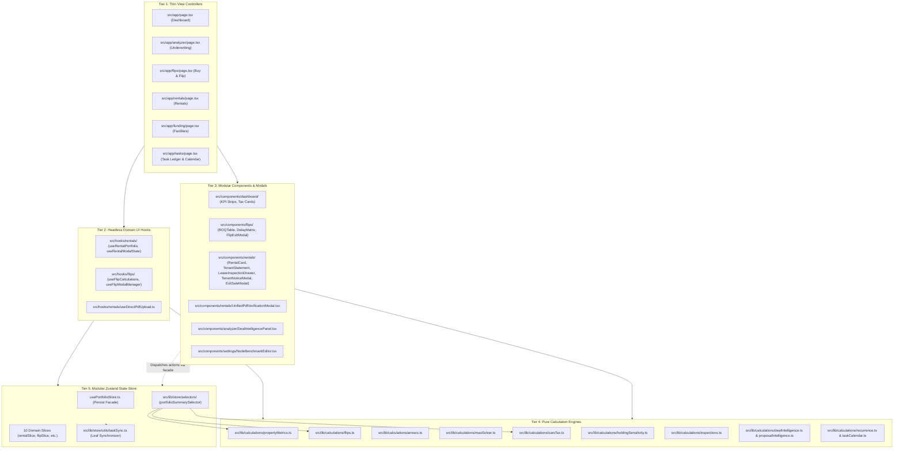
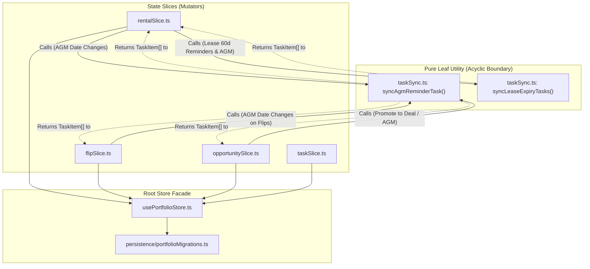
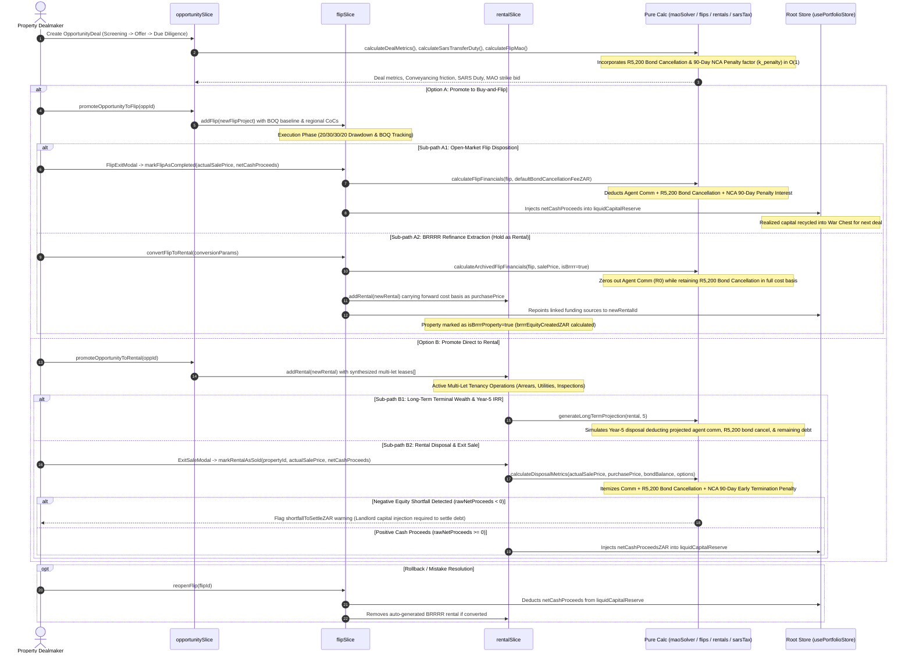
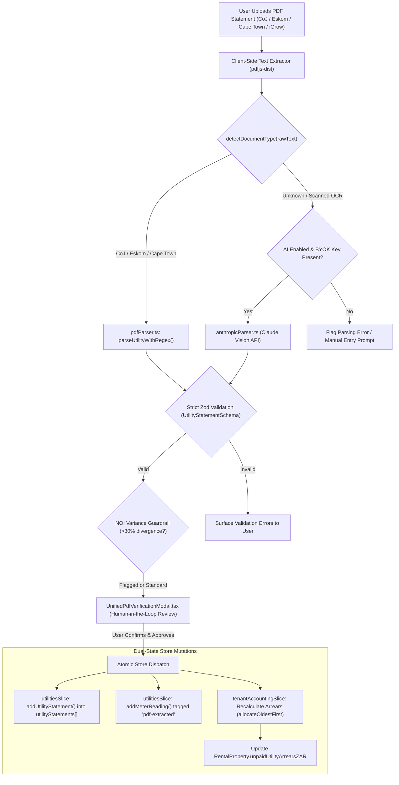
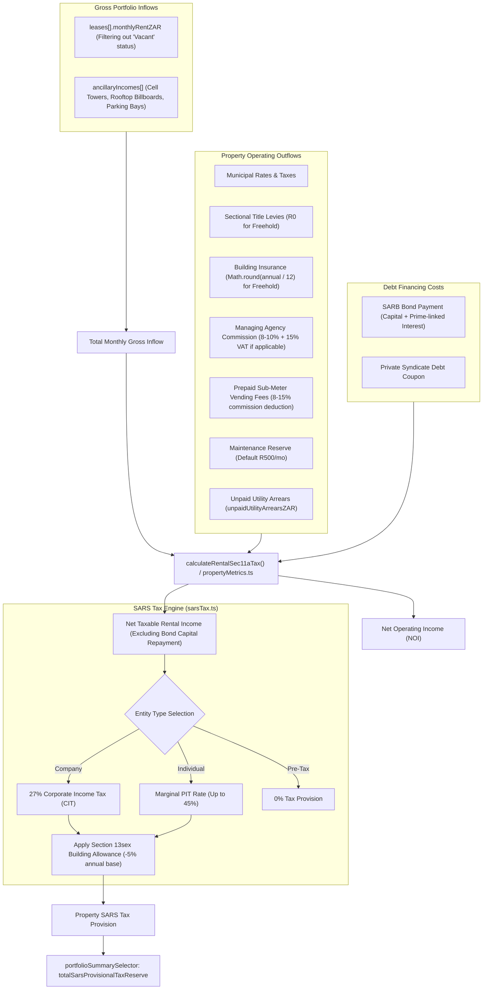
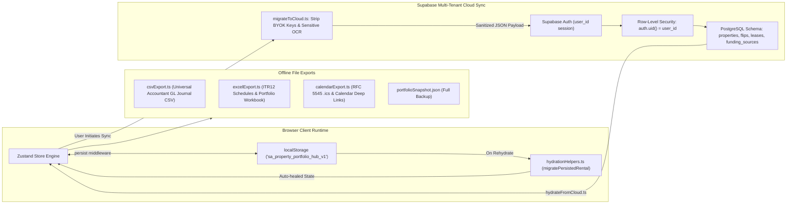
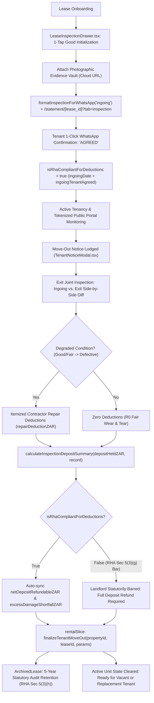

# Moremela Property Investment Hub: System Architecture & AI Context Blueprint

> **Status:** Institutional Reference & Definitive Architectural Standard  
> **Target Audience:** Principal Systems Architects, Full-Stack Engineers, and Autonomous AI Coding Agents  
> **System Baseline:** Next.js 16 (App Router), React 19, TypeScript 6, Tailwind CSS v4, Zustand v5  
> **Primary Jurisdiction:** Republic of South Africa (ZAR Institutional Real Estate Suite)

---

## 1. Architectural Philosophy: The 5-Tier Separation of Concerns (SoC)

The Moremela Property Investment Hub adheres to a rigid 5-tier unidirectional dependency architecture. To maintain long-term maintainability, eliminate circular references, and prevent logic fragmentation, code must never cross tier boundaries in an unauthorized direction.



### 1.1 Tier 1: Thin View Controllers (`src/app/*/page.tsx`)
- **Role:** Pure layout orchestration and client boundary mounting.
- **Constraints:**
  - Strictly declarative. No inline calculations (no raw tax math, yield division, or compound interest formulas).
  - Maximum file size target: `< 250 LOC`.
  - Responsible only for connecting Tier 2 domain hooks to Tier 3 visual components and passing action callbacks to the store facade.

### 1.2 Tier 2: Headless Domain UI Hooks (`src/hooks/`)
- **Role:** Coordinates form state, UI filter machines, modal visibility orchestration, and asynchronous client events.
- **Key Modules:**
  - [`useRentalPortfolio.ts`](file:///c:/Users/morok/OneDrive/L%20and%20M%20trading/src/hooks/rentals/useRentalPortfolio.ts): Assembles active vs. archived rental portfolios, executes CSV/Excel exports, handles optimistic write-offs and monthly rent marks.
  - [`useRentalModalState.ts`](file:///c:/Users/morok/OneDrive/L%20and%20M%20trading/src/hooks/rentals/useRentalModalState.ts): Centralized modal open/close state machine for 9 rental dialogs.
  - [`useFlipCalculations.ts`](file:///c:/Users/morok/OneDrive/L%20and%20M%20trading/src/hooks/flips/useFlipCalculations.ts): Bridges active flip project state into pure calculation results (`financials`, `fundingSummary`).
  - [`useFlipModalManager.ts`](file:///c:/Users/morok/OneDrive/L%20and%20M%20trading/src/hooks/flips/useFlipModalManager.ts): Centralized modal dispatcher for flips.
  - [`useDirectPdfUpload.ts`](file:///c:/Users/morok/OneDrive/L%20and%20M%20trading/src/hooks/rentals/useDirectPdfUpload.ts): Manages background OCR extraction and modal review triggers.

### 1.3 Tier 3: Modular Component Trees & Isolated Modals (`src/components/`)
- **Role:** Pure prop-driven visual presentation, tables, cards, and user interaction modals.
- **Constraints:**
  - Components receive formatted data or computed metrics via props.
  - Modals must be dynamically imported with `next/dynamic` (`{ ssr: false }`) in parent pages to eliminate code-bloat on initial SSR paint.
  - Must preserve standard `data-testid` attributes to support Playwright regression testing.
- **Key Modules & Isolated Modals:**
  - [`LeaseInspectionDrawer.tsx`](file:///c:/Users/morok/OneDrive/L%20and%20M%20trading/src/components/rentals/modals/LeaseInspectionDrawer.tsx): 15-second mobile "Tap-Only-What's-Broken" 8-category joint inspection drawer with Cloud Photo Vault integration and 1-click WhatsApp electronic delivery.
  - [`TenantNoticeModal.tsx`](file:///c:/Users/morok/OneDrive/L%20and%20M%20trading/src/components/rentals/modals/TenantNoticeModal.tsx): Tenant vacation modal providing side-by-side Ingoing vs. Exit condition diffing, automated degraded-item detection, contractor repair deductions, and live deposit refund auto-sync.
  - [`ExitSaleModal.tsx`](file:///c:/Users/morok/OneDrive/L%20and%20M%20trading/src/components/rentals/modals/ExitSaleModal.tsx): Rental disposal modal with itemized estate agent commission, conveyancer bond cancellation fee (`R5,200`), NCA Section 125 90-day early settlement penalty, and negative-equity shortfall warnings (`shortfallToSettleZAR`).
  - [`FlipExitModal.tsx`](file:///c:/Users/morok/OneDrive/L%20and%20M%20trading/src/components/flips/modals/FlipExitModal.tsx): Buy-and-flip exit modal reconciling sales commission, bond cancellation fees, and early settlement penalties against realized profit and capital recycling.
  - [`DealIntelligencePanel.tsx`](file:///c:/Users/morok/OneDrive/L%20and%20M%20trading/src/components/analyzer/DealIntelligencePanel.tsx): Collapsible multi-strategy verdict and automated deal-repair engine panel comparing underwriting metrics against 35 SA regional investment node baselines.
  - [`NodeBenchmarkEditor.tsx`](file:///c:/Users/morok/OneDrive/L%20and%20M%20trading/src/components/settings/NodeBenchmarkEditor.tsx): Regional node benchmark override manager with CSV/JSON import/export and remote Supabase synchronization.

### 1.4 Tier 4: Pure Calculation Engines (`src/lib/calculations/`)
- **Role:** 100% deterministic, side-effect-free financial, tax, and engineering mathematics.
- **Constraints:**
  - Zero imports from React, Next.js, or Zustand store slices.
  - Operates exclusively on plain TypeScript primitives and domain types from [`src/types/index.ts`](file:///c:/Users/morok/OneDrive/L%20and%20M%20trading/src/types/index.ts).
  - Zero division-by-zero vulnerabilities: every denominator must be guarded with `Math.max(1, ...)` or ternary checks.
  - Covered by comprehensive Vitest unit tests in `__tests__/`.
- **Key Calculation Engines:**
  - [`inspections.ts`](file:///c:/Users/morok/OneDrive/L%20and%20M%20trading/src/lib/calculations/inspections.ts) (Tested in [`__tests__/inspections.test.ts`](file:///c:/Users/morok/OneDrive/L%20and%20M%20trading/src/lib/calculations/__tests__/inspections.test.ts)): Pure 8-point RHA Section 5 inspection engine, `calculateInspectionDepositSummary`, `ensureInspectionItems`, and phone number normalization.
  - [`propertyMetrics.ts`](file:///c:/Users/morok/OneDrive/L%20and%20M%20trading/src/lib/calculations/propertyMetrics.ts): Cap rates, cashflow, IRR, DSCR, and Year-5 terminal exit disposal modeling.
  - [`dealIntelligence.ts`](file:///c:/Users/morok/OneDrive/L%20and%20M%20trading/src/lib/calculations/dealIntelligence.ts) & [`proposalIntelligence.ts`](file:///c:/Users/morok/OneDrive/L%20and%20M%20trading/src/lib/calculations/proposalIntelligence.ts): Deterministic multi-strategy deal scoring, automated deal-repair levers, and capital-stack funding structurer calibrated against [`investmentNodes.ts`](file:///c:/Users/morok/OneDrive/L%20and%20M%20trading/src/lib/constants/investmentNodes.ts).
  - [`flips.ts`](file:///c:/Users/morok/OneDrive/L%20and%20M%20trading/src/lib/calculations/flips.ts): Renovation milestone draws, sponsor sweat-equity savings, and holding/exit friction (`calculateFlipFinancials`, `calculateArchivedFlipFinancials`).
  - [`rentals.ts`](file:///c:/Users/morok/OneDrive/L%20and%20M%20trading/src/lib/calculations/rentals.ts): `calculateDisposalMetrics`, Section 11(a) tax provisions, and time-weighted occupancy YTD.
  - [`maoSolver.ts`](file:///c:/Users/morok/OneDrive/L%20and%20M%20trading/src/lib/calculations/maoSolver.ts): Maximum Allowable Offer closed-form inverse solver with $O(1)$ bid-dependent 90-day early settlement penalty factor $k_{\text{penalty}}$.
  - [`recurrence.ts`](file:///c:/Users/morok/OneDrive/L%20and%20M%20trading/src/lib/calculations/recurrence.ts) & [`taskCalendar.ts`](file:///c:/Users/morok/OneDrive/L%20and%20M%20trading/src/lib/calculations/taskCalendar.ts): Recurring task cadence engine (`Weekly`, `Monthly`, `Quarterly`, `Annually`), strict chronological sorting, overdue triage (`isTaskOverdue`), Monday-first 7-column calendar grid builder (`buildCalendarMonthGrid`), and future recurring ghost projections (`projectRecurringGhostTasks`).

### 1.5 Tier 5: Modular Zustand State Store (`src/lib/store/`)
- **Role:** Single source of truth for local-first reactive state, persistence, and cross-domain events.
- **Constraints:**
  - Slices are split into domain boundaries (`src/lib/store/slices/`).
  - Cross-domain task mutations must route through pure leaf utilities (`src/lib/store/utils/taskSync.ts`) to maintain an acyclic graph.
  - Persistence auto-heals outdated schema versions in `onRehydrateStorage` via [`portfolioMigrations.ts`](file:///c:/Users/morok/OneDrive/L%20and%20M%20trading/src/lib/store/persistence/portfolioMigrations.ts).

---

## 2. Zustand 10-Slice State Topology & Acyclic DAG

The application's reactive state is segmented across 10 modular slices assembled into a single store instance via the facade [`usePortfolioStore.ts`](file:///c:/Users/morok/OneDrive/L%20and%20M%20trading/src/lib/store/usePortfolioStore.ts).

### 2.1 Domain Slice Inventory

| Slice File | Managed State Fields | Key Actions & Business Handlers | Cross-Domain Side Effects |
| :--- | :--- | :--- | :--- |
| [`rentalSlice.ts`](file:///c:/Users/morok/OneDrive/L%20and%20M%20trading/src/lib/store/slices/rentalSlice.ts) | `rentals: RentalProperty[]` | `addRental`, `bulkAddRentals`, `reconcileImportedRentals`, `updateRental`, `deleteRental`, `markRentalAsSold`, `reopenRental`, `refinanceRental`, `markTenantNotice`, `cancelTenantNotice`, `finalizeTenantMoveOut` | - Modifies `liquidCapitalReserve` on property sale<br>- Invokes `syncLeaseExpiryTasks` (60-day lease reminders)<br>- Invokes `syncAgmReminderTask` for Body Corporate AGMs<br>- `finalizeTenantMoveOut`: Persists `inspectionRecord` and `depositRefundedZAR` onto `ArchivedLease` (5-year statutory audit trail per RHA Section 5) while scrubbing departing tenant inspection state when a unit transitions to vacant/replacement |
| [`flipSlice.ts`](file:///c:/Users/morok/OneDrive/L%20and%20M%20trading/src/lib/store/slices/flipSlice.ts) | `flips: FlipProject[]` | `addFlip`, `bulkAddFlips`, `updateFlip`, `deleteFlip`, `addBOQItem`, `updateBOQItem`, `deleteBOQItem`, `markFlipAsCompleted`, `reopenFlip`, `convertFlipToRental` | - `markFlipAsCompleted`: Injects `netCashProceeds` into `liquidCapitalReserve`<br>- `reopenFlip`: Deducts previous proceeds from `liquidCapitalReserve` and deletes converted rental<br>- `convertFlipToRental`: Constructs `RentalProperty`, transfers cost basis, repoints `funding[]` debt facilities, syncs AGM tasks |
| [`opportunitySlice.ts`](file:///c:/Users/morok/OneDrive/L%20and%20M%20trading/src/lib/store/slices/opportunitySlice.ts) | `opportunities: OpportunityDeal[]` | `addOpportunity`, `bulkAddOpportunities`, `updateOpportunity`, `deleteOpportunity`, `duplicateOpportunity`, `passOpportunity`, `reactivateOpportunity`, `advanceOpportunityStage`, `promoteOpportunityToFlip`, `promoteOpportunityToRental` | - `promoteOpportunityToFlip`: Creates new `FlipProject`, calculates transfer duty & legal costs, applies regional CoC defaults, spawns AGM reminder<br>- `promoteOpportunityToRental`: Creates new `RentalProperty`, synthesizes unit `leases[]`, calculates bond repayments |
| [`fundingSlice.ts`](file:///c:/Users/morok/OneDrive/L%20and%20M%20trading/src/lib/store/slices/fundingSlice.ts) | `funding: FundingSource[]` | `addFunding`, `updateFunding`, `deleteFunding`, `syncFundingWithDealDelay` | - Modifies total private funding liabilities and drawn liquidity in portfolio summary |
| [`utilitiesSlice.ts`](file:///c:/Users/morok/OneDrive/L%20and%20M%20trading/src/lib/store/slices/utilitiesSlice.ts) | Stateless actions operating on `RentalProperty` | `addUtilityStatement`, `deleteUtilityStatement`, `setStatementTenantBillingMethod`, `addMeterReading`, `deleteMeterReading`, `updateMeterReadingDispute`, `addPropertyMeter`, `updatePropertyMeter`, `deletePropertyMeter` | - Re-indexes `utilityStatements[]` and `meterReadings[]`<br>- Automatically triggers `calculatePropertyArrears` and updates `unpaidUtilityArrearsZAR` |
| [`tenantAccountingSlice.ts`](file:///c:/Users/morok/OneDrive/L%20and%20M%20trading/src/lib/store/slices/tenantAccountingSlice.ts) | Stateless actions operating on `RentalProperty` | `recordTenantPayment`, `updateTenantPayment`, `deleteTenantPayment`, `recordArrearsWriteOff`, `deleteArrearsWriteOff`, `updateArrearsOpeningBalance`, `addTransaction`, `deleteTransaction` | - Re-runs FIFO arrears allocation engine<br>- Synchronizes property `unpaidUtilityArrearsZAR` and tenant ledger balances |
| [`taskSlice.ts`](file:///c:/Users/morok/OneDrive/L%20and%20M%20trading/src/lib/store/slices/taskSlice.ts) | `tasks: TaskItem[]` | `addTask`, `toggleTaskStatus`, `updateTask`, `deleteTask` | - Spawns next recurring task cycle via [`handleTaskCompletionRecurrence`](file:///c:/Users/morok/OneDrive/L%20and%20M%20trading/src/lib/calculations/recurrence.ts) upon completion |
| [`directorySlice.ts`](file:///c:/Users/morok/OneDrive/L%20and%20M%20trading/src/lib/store/slices/directorySlice.ts) | `suppliers: LocalSupplier[]`, `municipalDirectory: MunicipalContact[]` | `addSupplier`, `deleteSupplier`, `addMunicipalContact`, `updateMunicipalContact`, `deleteMunicipalContact`, `resetMunicipalDirectory` | - Provides phone/email contacts for municipal council escalations and trade accounts |
| [`settingsSlice.ts`](file:///c:/Users/morok/OneDrive/L%20and%20M%20trading/src/lib/store/slices/settingsSlice.ts) | `liquidCapitalReserve`, `investorProfile` (including `defaultBondCancellationFeeZAR`), `analyzerDraft`, `aiSettings`, `rentalForecastView`, `completedGuideSteps` | `updateLiquidReserve`, `updateInvestorProfile`, `updateAiSettings`, `updateAnalyzerDraft`, `setRentalForecastView`, `toggleGuideStep`, `resetGuideProgress` | - Drives global portfolio summary war chest calculations, conveyancing bond cancellation defaults (R5,200), and tax entity routing (CIT 27% vs. PIT 45%) |
| [`systemSlice.ts`](file:///c:/Users/morok/OneDrive/L%20and%20M%20trading/src/lib/store/slices/systemSlice.ts) | System-level maintenance actions | `getSummary`, `hydrateFromCloudState`, `resetToDemoData`, `clearAllData`, `importPortfolioJSON` | - Coordinates cloud merge synchronization and full portfolio JSON backups |

---

### 2.2 Acyclic Task Synchronization DAG

To eliminate circular dependency chains between `rentalSlice`, `flipSlice`, `opportunitySlice`, and `taskSlice`, task mutation logic is decoupled into a pure leaf utility module: [`src/lib/store/utils/taskSync.ts`](file:///c:/Users/morok/OneDrive/L%20and%20M%20trading/src/lib/store/utils/taskSync.ts).



**Architectural Law:** Slices must never import from each other. Cross-slice state reads are achieved via the Zustand `get()` accessor inside actions, and cross-slice task synchronization must strictly call `taskSync.ts` pure transform functions that accept `tasks: TaskItem[]` and return a new `TaskItem[]`.

---

## 3. Core System Data Flows

### 3.1 Deal Lifecycle & Exit Waterfall (Flow 1)

Illustrates the end-to-end progression from deal underwriting through execution, capital recovery, and dual-exit mechanics, incorporating statutory legal fees and National Credit Act early settlement penalties.



---

### 3.2 Smart Utility & Meter Ingestion Pipeline

Illustrates automated municipal and managing agent PDF parsing, client-side regex processing, fallback AI extraction, human verification, and atomic store ledger updates.



---

### 3.3 Multi-Let & Ancillary Cashflow Aggregation to SARS Tax Reserve

Illustrates how multi-tenant revenues, commercial ancillary streams, prepaid vending commissions, and debt obligations resolve into Net Operating Income and SARS provisional tax reserves.



---

### 3.4 Local-First Persistence & Cloud Sync Architecture

Illustrates the local-first storage hierarchy, client-side exports, and secure Supabase cloud sync with zero-leakage security boundaries.



---

### 3.5 RHA Section 5 Joint Inspection & Deposit Settlement Lifecycle (Flow 5)

Illustrates the end-to-end statutory inspection lifecycle governed under **Section 5(3)(e)–(k) of the South African Rental Housing Act (Act 50 of 1999)**, tracking joint ingoing inspection handshakes, automated degraded-condition detection, contractor repair deductions, and 5-year statutory audit archiving.



**Lifecycle Phases & Domain Rules:**
1. **Onboarding & 1-Tap Initialization:** The landlord initializes the 8 standard categories (`DEFAULT_INSPECTION_CATEGORIES`) set to `"Good"` in [`LeaseInspectionDrawer.tsx`](file:///c:/Users/morok/OneDrive/L%20and%20M%20trading/src/components/rentals/modals/LeaseInspectionDrawer.tsx). The landlord adjusts any existing defects in seconds and attaches Cloud Photo Vault evidence.
2. **Delivery & Electronic Tenant Handshake:** Ingoing report is transmitted via WhatsApp ([`formatInspectionForWhatsApp`](file:///c:/Users/morok/OneDrive/L%20and%20M%20trading/src/lib/whatsappFormatter.ts)) alongside deep links to [`/statement/[lease_id]?tab=inspection`](file:///c:/Users/morok/OneDrive/L%20and%20M%20trading/src/app/statement/[lease_id]/page.tsx). Tenant reviews and clicks 1-tap WhatsApp confirmation ("AGREED").
3. **Statutory Deduction Gate (RHA Section 5(3)(g)):** `isRhaCompliantForDeductions` requires both `ingoingDate` and `ingoingTenantAgreed === true`. If the landlord neglects the joint ingoing inspection, Section 5(3)(g) of Act 50 of 1999 legally deems the property received in good order and bars repair deductions upon vacation.
4. **Exit Inspection & Degraded-Item Diffing:** Upon notice, [`TenantNoticeModal.tsx`](file:///c:/Users/morok/OneDrive/L%20and%20M%20trading/src/components/rentals/modals/TenantNoticeModal.tsx) performs side-by-side comparison against the ingoing baseline. Items that were `Good` or `Fair` but degraded to `Defective` are surfaced for itemized contractor repair costing (`repairDeductionZAR`).
5. **Deposit Settlement Auto-Sync & Archival:** [`calculateInspectionDepositSummary`](file:///c:/Users/morok/OneDrive/L%20and%20M%20trading/src/lib/calculations/inspections.ts) dynamically computes `netDepositRefundableZAR` and flags `excessDamageShortfallZAR`. Calling `finalizeTenantMoveOut` commits the full audit trail to `ArchivedLease` (statutorily preserved for 5 years per Section 5(3)(h)) and scrubs `inspectionRecord` from active unit state.

---

## 4. South African Domain Invariants ("Laws of the Codebase")

Any engineer or autonomous AI agent modifying this codebase must adhere strictly to these non-negotiable domain rules:

### 4.1 Currency & Precision Invariants
1. **ZAR Primitives:** All monetary amounts are denominated in South African Rand (ZAR) as floating-point `number` primitives. No multi-currency abstractions exist.
2. **Defensive Denominators:** Yield and ROI calculations must never divide by zero. All calculations must guard against zero or undefined values:
   ```typescript
   // CANONICAL PATTERN:
   const grossYield = marketValueZAR > 0 ? (annualRentZAR / marketValueZAR) * 100 : 0;
   ```
3. **Integer Cent Rounding:** Final ledger exports and tax figures must be rounded to whole integers or standard currency decimals via [`src/lib/formatters.ts`](file:///c:/Users/morok/OneDrive/L%20and%20M%20trading/src/lib/formatters.ts).

### 4.2 Multi-Let Canonical Structure
1. **The `leases[]` Array is Mandatory:** Every `RentalProperty` stores tenants inside `leases: Lease[]`.
2. **No Flat Tenant Fields:** Single-let properties are modeled as `leases.length === 1`. Never introduce `tenantName`, `monthlyRent`, or `leaseEndDate` directly onto the root `RentalProperty` interface.
3. **Multi-Unit Vacancy Isolation:** When calculating rental gross inflows, inactive or vacant units must be excluded:
   ```typescript
   // CANONICAL PATTERN:
   const activeGross = r.leases
     ?.filter((l) => l.status !== 'Vacant')
     .reduce((sum, l) => sum + (l.monthlyRentZAR || 0), 0) || 0;
   ```

### 4.3 Utility Regimes & Dispute Mechanics
1. **Regime Types:** Properties operate under one of three regimes: `'postpaid' | 'prepaid_submeter' | 'hybrid'`.
2. **Prepaid Sub-Metering NOI Deductions:** Prepaid sub-meter vending fees (typically 8–15%) deduct from monthly NOI as an operational fee, but do **not** affect base lease rent.
3. **Dispute State Isolation:** Disputed municipal readings (`MeterDisputeStatus !== 'None'`) freeze collection escalation on that meter while preserving normal monthly base rent collection from tenants.

### 4.4 BRRRR Equity Extraction Invariants
An automated Equity Extraction Alert is triggered if and only if two simultaneous criteria are met:
1. **Stabilization Seasoning:** Property holding duration since purchase is `>= 6 months`.
2. **LTV Threshold:** Current Loan-to-Value is strictly less than 70% (`ltv < 0.70`).
3. **Extraction Limit:** Refinance capacity is calculated strictly up to 80% of current market valuation minus outstanding bond liabilities:
   ```typescript
   // CANONICAL PATTERN:
   const extractableEquityZAR = Math.max(0, (marketValueZAR * 0.80) - outstandingBondBalanceZAR);
   ```

### 4.5 South African Statutory & Tax Standards
1. **Progressive SARS Transfer Duty:** Calculations must strictly evaluate 2024–2026 SARS tax bands:
   - R0 to R1,100,000: 0%
   - R1,100,001 to R1,512,500: 3% of value above R1,100,000
   - R1,512,501 to R2,117,500: R12,375 + 6% of value above R1,512,500
   - R2,117,501 to R2,722,500: R48,675 + 8% of value above R2,117,500
   - R2,722,501 to R12,100,000: R97,075 + 11% of value above R2,722,501
   - R12,100,001 and above: R1,128,600 + 13% of value above R12,100,000
2. **Section 118(1) Clearance Debt Isolation:** In distressed auction underwriting, Section 118 municipal arrears (historical 2-year council debt) must be isolated into `sec118ArrearsZAR` and treated as an acquisition cost reducing the maximum allowable bid.
3. **Section 13sex Tax Shield:** Allows a 5% annual depreciation allowance on the cost base of new and unused residential units acquired by a taxpayer owning at least 5 residential units in South Africa used solely for trade.
4. **VAT Treatment:**
   - Residential tenant rent is an **exempt supply** under Section 12(a) of the South African VAT Act (no VAT charged on rent).
   - Commercial managing agent commission and cellular mast leases attract standard **15% VAT**.
5. **RHA Section 5 Statutory Deduction Gate (Act 50 of 1999):** Under Section 5(3)(e)–(g) of the South African Rental Housing Act, `isRhaCompliantForDeductions` requires both `ingoingDate` and `ingoingTenantAgreed === true`. If either is false or missing, the landlord is statutorily presumed to have accepted the dwelling in good order and is legally barred from claiming damages or deducting contractor repair costs from the tenant's security deposit upon vacation.
6. **NCA Section 125 90-Day Early Settlement Penalty:** Under Section 125 of the National Credit Act (Act 34 of 2005), credit providers are entitled to charge up to 90 days of interest when a consumer settles a credit facility without providing 90 calendar days' written notice. In geared property disposals where notice was not given, this penalty is modeled as `3 * monthlyBondPaymentZAR` or `Math.round(bondBalance * (interestRate / 100) * (90 / 365))`, or overridden by an explicit bank settlement quote.
7. **LSSA Conveyancing Bond Cancellation Tariff:** Conveyancer bond cancellation legal fees default to `R5,200` incl. 15% VAT, reflecting the Legal Practice Council / Law Society of South Africa (LSSA) recommended base cancellation tariff, Deeds Office cancellation levy, and bank cancellation instruction fee.

### 4.6 Architectural & AI Coding Agent Guardrails
1. **Zero Inline Math in JSX:** Never embed mathematical calculations or business rules inside component render blocks. Delegate strictly to [`src/lib/calculations/`](file:///c:/Users/morok/OneDrive/L%20and%20M%20trading/src/lib/calculations/).
2. **Playwright E2E Stability:** Never delete or alter `data-testid` attributes on interactive inputs, tables, or buttons.
3. **Security & POPIA Hygiene:** Never transmit or store raw BYOK API keys (OpenAI, Anthropic, Gemini) in remote Supabase tables. Cloud migration mappers must explicitly strip API keys (`apiKey: ''`).
4. **Acyclic Synchronization:** Never import state slices into other state slices. Use `taskSync.ts` for all inter-domain task workflows.
5. **Strict Zero-Override Nullish Guard (`!== undefined && !== null`):** Fee and penalty overrides (`bondCancellationFeeZAR`, `earlyTerminationPenaltyZAR`, `repairDeductionZAR`) must NEVER use truthy `||` fallbacks. A user-entered `0` (e.g. a negotiated bank fee waiver, an unrepresented private sale commission waiver, or a zero-deduction repair) is a valid, intentional financial override that would be mistakenly erased by `|| defaultFee`:
   ```typescript
   // CANONICAL PATTERN:
   const bondCancellationFeeZAR = !hasBond
     ? 0
     : (flip.bondCancellationFeeZAR !== undefined && flip.bondCancellationFeeZAR !== null
         ? flip.bondCancellationFeeZAR
         : defaultBondCancellationFeeZAR);
   ```
6. **Closed-Form MAO Penalty Synchronization:** When `earlyTerminationNoticeGiven === false` on a geared flip (`bondLtvPercent > 0`), `calculateFlipMao` incorporates the bid-dependent early settlement penalty into the closed-form algebraic denominator:
   $$k_{\text{penalty}} = \left(\frac{\text{LTV}}{100}\right) \times \left(\frac{\text{Rate}}{100}\right) \times \left(\frac{90}{365}\right)$$
   $$\text{MAO} = \frac{\text{Net Allowable Outlay}}{1 + \text{acqRate} + k_{\text{eviction}} + k_{\text{penalty}}}$$
   This guarantees exact $O(1)$ evaluation without circular numerical loops or iterative convergence drift.
7. **Strict ASCII / Emoji-Free WhatsApp Formatting:** All `whatsappFormatter.ts` templates (including `formatInspectionForWhatsApp`, syndicate pitch copy, and payment receipts) must remain strictly free of Unicode emojis, utilizing clean ASCII brackets (e.g. `[Good]`, `[Defective]`, `[Tenant Agreed]`), bullets (`•`), and standard typography to ensure complete test compliance with `whatsappFormatter.test.ts` and cross-platform compatibility across all mobile SMS/WhatsApp gateways.
