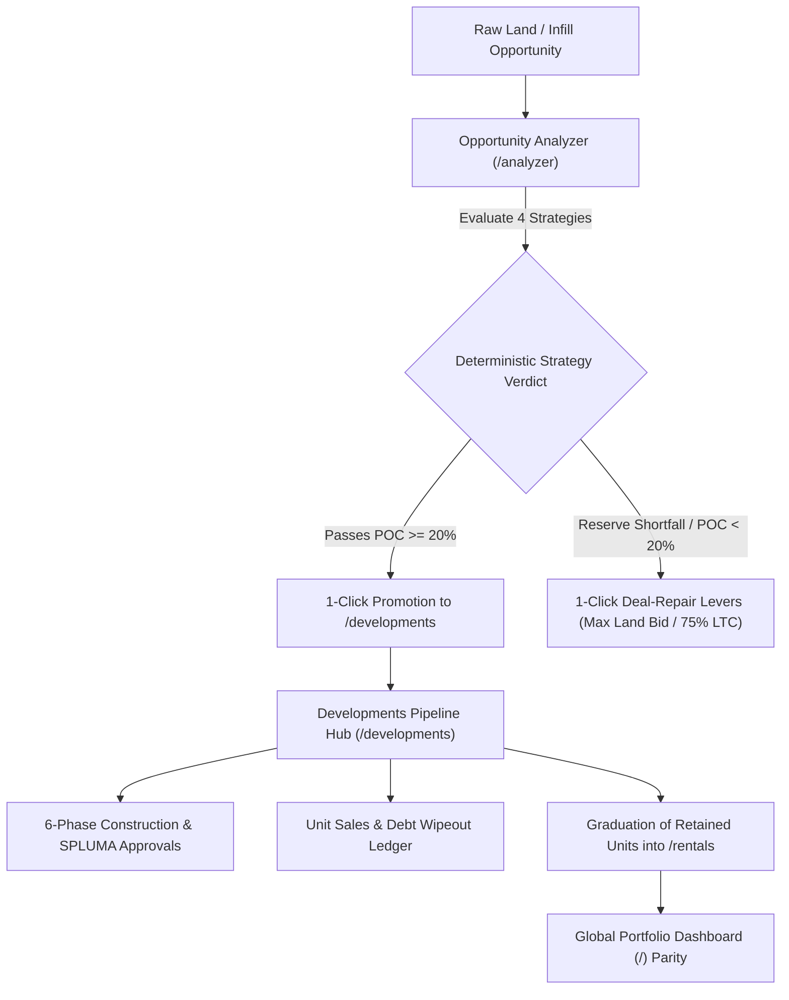

# South African Property Hub — Developments Module & 4-Strategy Engine Walkthrough

> **Platform Version:** SA Property Hub v2.8.0  
> **Target Jurisdiction:** Republic of South Africa (SPLUMA 16 of 2013, Sectional Titles Schemes Management Act 8 of 2011, Housing Consumers Protection Measures Act 95 of 1998, SARS VAT Act 89 of 1991, Income Tax Act 58 of 1962 Sec 13sex)  
> **Status:** Production Ready • 100% Verified Tests • Supabase Live

---

## 1. Executive Summary & Architectural Evolution

Prior to this release, SA Property Hub operated on a **3-Strategy Investment Matrix**:
1. **Buy & Hold Rental** (Cash flow, net cap rates, tenant vetting, and SARS Section 11(a) tax shields)
2. **Buy & Flip** (Short-term capital recycling, BOQ milestone draws, municipal Section 118 clearance, and SARS 27% Corporate Income Tax reserves)
3. **Hybrid BRRRR** (Buy, Rehab, Rent, Refinance, Repeat; Day-1 equity recycling, post-refi cashflow, and bank refinancing sensitivity)

While sufficient for single-erf acquisitions and distressed sheriff auctions, this omitted South Africa's most lucrative wealth-creation mechanism: **Ground-Up Residential & Multi-Unit Cluster Developments**.

With the rollout of the **Developments Module & Strategy 4 Engine**, the platform now provides end-to-end institutional capabilities covering:
- **Opportunity Analyzer (`/analyzer`)**: Underwriting raw land bids, buildable bulk (m²), SPLUMA Sec 42 bulk contributions, 8-line professional fees, 2-stage timeline burn (Pre-Approval vs Superstructure), and S-Curve construction facility interest.
- **Dedicated Hub (`/developments`)**: Managing complex multi-unit projects across a 6-phase lifecycle from feasibility to sectional title registration, tracking senior debt facilities, pre-sales velocity, and unit graduation into `/rentals`.
- **Global Portfolio Dashboard (`/`)**: 100% accounting parity reconciling unsold development asset values (`developmentsValueZAR`) and drawn senior facility liabilities (`totalDevelopmentDebtLiability`) across net equity and a 4-slice Asset Allocation Donut chart.
- **Investor Settings (`/settings`)**: Dynamic user-configurable Development Buy Box hurdles (Min POC %, Min YoC %, Hard Build Rate R/m², and VAT-Registered Developer toggle).
- **Supabase Cloud Database**: Remote table `public.developments` with Row-Level Security (RLS) and synced `profiles` columns.
- **PostHog Analytics**: Privacy-safe telemetry capturing every step of the developer funnel.



---

## 2. Global Portfolio Dashboard (`/`) Accounting Reconciliation

To ensure zero mathematical drift between single-unit rentals, flips, and high-value multi-unit developments:

### 2.1 Unsold Asset Valuation Without Double-Counting
In `src/lib/store/selectors/portfolioSummarySelector.ts`, the portfolio asset value contribution of active developments (`developmentsValueZAR`) sums `listPriceVatInclZAR` strictly for developer-owned units:
$$\text{developmentsValueZAR} = \sum_{dev \in \text{developments}} \left( \sum_{u \in dev.units, u.status \ne \text{'Sold \& Transferred'}, \neg u.graduatedRentalId} u.listPriceVatInclZAR \right)$$
- Units marked `Sold & Transferred` are excluded.
- Units graduated into the active rental portfolio (`graduatedRentalId` set) are excluded to ensure zero double-counting with `totalRentalValue`.

### 2.2 Senior Debt Liability & Portfolio Gearing (LTV)
Drawn senior development facilities are reconciled into total liabilities:
$$\text{totalDevelopmentDebtLiability} = \sum_{dev \in \text{developments}} \max(0, dev.developmentFacilityDrawnZAR - dev.developmentFacilityRepaidZAR)$$
$$\text{totalLiabilities} = \text{totalBondLiabilities} + \text{totalPrivateFundingLiability} + \text{totalDevelopmentDebtLiability}$$
$$\text{netEquity} = \text{totalGrossAssetValue} - \text{totalLiabilities}$$

### 2.3 4-Slice SVG Asset Allocation Donut Chart
The donut chart on `src/app/page.tsx` renders 4 distinct slices:
1. **Active Rentals** (`#10b981` Emerald)
2. **Ongoing Flips** (`#3b82f6` Blue)
3. **Active Developments** (`#8b5cf6` Violet, 52.3% in demo portfolio)
4. **Liquid Cash Reserve** (`#f59e0b` Amber)

Legend items sum precisely to 100% of Total Assets, and the property count sub-label displays combined assets across rentals, flips, and developments.

### 2.4 Active Developments Pipeline Card
Next to Active Buy-and-Flips, the dashboard displays high-signal development pipeline metrics:
- **Total TDC**: e.g., `R 7 037 650`
- **Target GDV**: e.g., `R 8 200 000`
- **Scale**: e.g., `6 Units (390 m²)`
- **POC Margin**: e.g., `+16.5% POC` (hurdle-colored pill)

---

## 3. Opportunity Analyzer (`/analyzer`): Strategy 4 Engine

### 3.1 Buildable Bulk Guardrail & Micro-Unit Floor
When switching to `Development` or adjusting unit counts, if average unit size ($\frac{\text{totalBuildableSqm}}{\text{plannedUnits}}$) drops below South Africa's statutory $24\text{ m}^2$ micro-unit minimum, the engine automatically scales bulk floor area to $\text{plannedUnits} \times 65\text{ m}^2$ and surfaces an inline amber quick-fix pill:
> `⚠️ Avg 11 m²/unit is below SA 24 m² micro-unit minimum — [Set to 390 m² (65 m²/unit)]`

### 3.2 Non-Truncating Scheme Type Selector
The 4 development typologies display clean, full-width badges:
- `Subdivision Cluster`: Freehold cluster schemes on subdivided erfs
- `Sectional Title`: Multi-storey walk-up apartment blocks
- `Township Infill`: Backyard rental rooms / micro-apartments under township economic schemes
- `Comm-to-Resi`: Commercial office-to-residential conversions

### 3.3 Institutional Cost Stacking & 8-Item SPLUMA Schedule
The development cost engine models hard construction, contingencies, and itemized soft costs:
- **Hard Construction**: Calculated dynamically as $\text{totalBuildableAreaSqm} \times \text{hardCostPerSqmZAR}$ (defaulting to the user's `defaultHardBuildRatePerSqmZAR` setting, e.g., $\text{R } 9\ 800/\text{m}^2$).
- **Contingency Buffer**: Default 7.5% for geotechnical and BOQ overruns.
- **8-Item Professional Team & SPLUMA Sec 42 Schedule**:
  1. Town Planner (SPLUMA rezoning and township establishment)
  2. Architect & SDP Submission Plans
  3. Structural & Civil Engineers (Services agreement and foundation design)
  4. Quantity Surveyor (QS bills of quantities and draw sign-offs)
  5. NHBRC Enrolment Fee (Act 95 of 1998 warranty)
  6. SPLUMA Section 42 Council Bulk Contributions (Water, sewer, electrical connection levies)
  7. Municipal Plan Scrutiny & Deeds Office Subdivision Fees
  8. Marketing, Signage & Show Unit Staging

### 3.4 2-Stage Timeline & Holding Burn
Carrying costs are split into 2 realistic development phases:
- **Stage 1: Pre-Approval (4-12 months)**: Municipal SPLUMA rezoning and council scrutiny holding period. Site security, rates, and town planning burn.
- **Stage 2: Construction (6-18 months)**: Physical construction phase. Base site burn plus S-Curve construction interest on drawn senior debt.

### 3.5 3-Mode Development Exit Allocation
Developers can model three distinct exit strategies:
1. **100% Build-to-Sell**: All units marketed and sold off-plan.
2. **Split-Exit Hybrid**: Developer sells sufficient units to pay off the senior debt facility, retaining the remaining units **100% debt-free** for the permanent rental portfolio.
3. **100% Build-to-Rent (BTR)**: All units retained; evaluated on Yield on Cost (YoC %) and long-term cashflow.

### 3.6 Senior Development Facility & SARB Stress-Testing
- **Senior Debt LTC %**: Configurable loan-to-cost (65%-80% for TUHF / DFI / Commercial banks).
- **S-Curve Drawdown Utilization**: Default 60% average balance factor over the build cycle.
- **SARB Stress Test Strip**: 3 rate-shock scenarios ($0\text{ bps}$, $+100\text{ bps}$, $+200\text{ bps}$) bound to the Senior Development Facility limit, displaying interim monthly interest and total construction interest carry.

### 3.7 Deterministic Strategy Verdict & Deal-Repair Engine
When `Development` strategy is active, the engine evaluates **4 Development Hurdles**:
1. **Profit on Cost (POC %)**: $\ge \text{minDevPocPercent}$ (default 20.0%)
2. **Yield on Cost (BTR YoC %)**: $\ge \text{minDevYocPercent}$ (default 12.0%)
3. **Debt Wipeout Breakeven**: Units required to clear senior facility $\le 65\%$ of total scheme units
4. **Developer Equity vs War Chest**: Required equity $\le$ liquid capital reserve

If any hurdle fails, the **Deal-Repair Engine** provides 1-click corrective levers:
- **Apply Max Allowable Land Bid**: Solves the maximum land acquisition price to hit 20% POC or match the investor's War Chest reserve.
- **Increase Senior LTC to 75% / 80% (TUHF/DFI)**: Expands senior debt to eliminate equity shortfalls.
- **Required Scheme GDV**: Solves target unit list pricing required to clear hurdle margins.

---

## 4. Developments Dedicated Hub (`/developments`)

The dedicated `/developments` workspace provides full operational management:

```
┌─────────────────────────────────────────────────────────────────────────────────┐
│ Top 6-Card Executive Strip                                                      │
│ Total TDC  │ Target GDV │ Unrealized Dev Equity │ Senior Debt │ Pre-Sales │ Approvals│
├─────────────────────────────────────────────────────────────────────────────────┤
│ Active Project Selector & 6-Phase Pipeline Stepper                              │
│ Feasibility ➔ Land/Rights ➔ Earthworks ➔ Superstructure ➔ Finishes ➔ Handover   │
├─────────────────────────────────────────────────────────────────────────────────┤
│ Tab 1: Unit Inventory & Sales Ledger (Graduation to /rentals)                    │
│ Tab 2: Development Financials, S-Curve Debt & Wipeout Matrix                    │
│ Tab 3: Statutory Approvals & SPLUMA Sec 42 Compliance Checklist                  │
│ Tab 4: Bill of Quantities (BOQ) & Contractor Milestone Draws                    │
└─────────────────────────────────────────────────────────────────────────────────┘
```

- **Unit Graduation Engine**: Retained units can be graduated into `/rentals` with a single click. A linked `RentalProperty` is generated with tenant details and market rent, while the unit in `/developments` is stamped with `graduatedRentalId` to maintain strict accounting integrity.
- **WhatsApp Investor Tear-Sheet**: Formatted South African rand summaries ready to share with lenders and syndicate partners.

---

## 5. Platform Settings (`/settings`): Buy Box Configuration

In `src/app/settings/page.tsx`, investors can customize their development underwriting parameters:

1. **Min Development POC Hurdle (%)**: Sets `minDevPocPercent` (default `20.0%`). Drives the primary hurdle in `/analyzer` and deal intelligence verdicts.
2. **Min Build-to-Rent YoC (%)**: Sets `minDevYocPercent` (default `12.0%`). Controls BTR scheme feasibility.
3. **Default Hard Build Rate (R/m²)**: Sets `defaultHardBuildRatePerSqmZAR` (default `R 9 800/m²`). Pre-populates new development drafts and project modal defaults.
4. **Default VAT-Registered Developer Toggle**: Sets `defaultVatRegisteredDeveloper` (default `true`). Controls whether 15% input VAT claims on construction materials and professional fees are enabled by default.

---

## 6. Supabase Cloud Database Architecture

### 6.1 `public.developments` Table
Applied to remote project `wawpfdbymgseodftemsz` via Supabase MCP:
- **Columns (36)**: `id`, `user_id`, `title`, `address`, `city`, `province`, `investment_node_id`, `development_type`, `is_vat_registered_developer`, `tax_entity_type`, `current_phase`, `pre_approval_months`, `construction_months`, `sell_down_months`, `land_purchase_price_zar`, `acquisition_costs_zar`, `sec118_arrears_zar`, `soft_costs`, `total_buildable_area_sqm`, `budgeted_hard_cost_per_sqm_zar`, `contingency_percent`, `boq_items`, `monthly_pre_approval_holding_burn_zar`, `monthly_construction_holding_burn_zar`, `development_facility_limit_zar`, `development_facility_drawn_zar`, `development_facility_repaid_zar`, `pre_sales_hurdle_percent`, `linked_funding_source_id`, `approvals`, `units`, `compliance`, `drive_vault`, `notes`, `created_at`, `updated_at`.
- **Row-Level Security (RLS)**: Enabled with 4 isolated policies ensuring users access only their own records (`developments_select_own`, `developments_insert_own`, `developments_update_own`, `developments_delete_own`).

### 6.2 `public.profiles` Extension
Added 4 columns to persist the user's development mandate:
```sql
ALTER TABLE public.profiles 
  ADD COLUMN IF NOT EXISTS min_dev_poc_percent NUMERIC DEFAULT 20.0,
  ADD COLUMN IF NOT EXISTS min_dev_yoc_percent NUMERIC DEFAULT 12.0,
  ADD COLUMN IF NOT EXISTS default_hard_build_rate_per_sqm_zar NUMERIC DEFAULT 9800,
  ADD COLUMN IF NOT EXISTS default_vat_registered_developer BOOLEAN DEFAULT true;
```
- Integrated with `src/lib/db/migrateToCloud.ts` for cloud pushes.
- Integrated with `src/lib/db/hydrateFromCloud.ts` for profile hydration on login.
- Integrated with `src/types/supabase.ts` for strict compile-time TypeScript typing.

---

## 7. PostHog Telemetry & Lifecycle Analytics

Privacy-safe analytics track user actions across the development lifecycle:
- `development_created`: Logged on new project initialization.
- `development_promoted_from_analyzer`: Logged when an opportunity is promoted directly into the developments pipeline.
- `development_unit_sold`: Logged when a unit status transitions to `Sold & Transferred`.
- `development_units_graduated_to_rental`: Logged when retained units are graduated into `/rentals`.
- `development_tab_switched`: Logged on sub-tab navigation (`units`, `financials`, `approvals`, `boq`).
- `development_whatsapp_copied`: Logged when a deal tear-sheet is exported for WhatsApp.

---

## 8. Verification & Quality Assurance Audit

| Test Suite / Check | Result | Details |
| :--- | :---: | :--- |
| **TypeScript Compilation** (`tsc --noEmit`) | **PASS** | 0 errors across all routes, stores, types, and DB mappers |
| **Developments Core Math** (`developments.test.ts`) | **PASS** | 45/45 tests passing (TDC, GDV, S-Curve, debt wipeout, VAT) |
| **Deal Intelligence** (`dealIntelligence.test.ts`) | **PASS** | 6/6 tests passing (4-strategy ranking & 1-click repair levers) |
| **Property Metrics** (`propertyMetrics.test.ts`) | **PASS** | 15/15 tests passing (Rate shock stress testing & DSCR) |
| **PostHog Analytics** (`PostHogProvider.test.tsx`) | **PASS** | 10/10 tests passing (Privacy-safe events & mock boundaries) |
| **Supabase Remote DB** | **PASS** | RLS active, `developments` table live, `profiles` columns synchronized |

---

*Authored by Antigravity AI Coding Assistant for SA Property Hub.*
